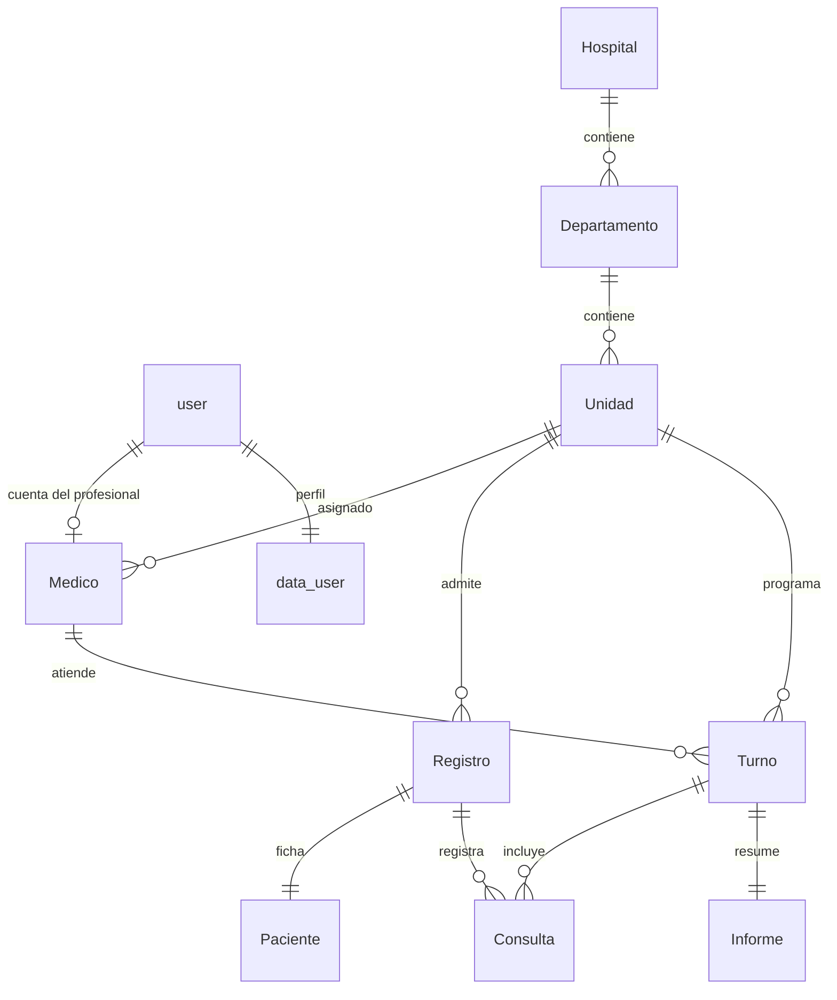

# Base de datos · Proyecto-DW

Rediseño del esquema relacional del Sistema de Gestión Hospitalaria para
PostgreSQL 17. Integra el ERD entregado, las tablas de usuarios que ya existían
(`user` y `data_user`) y la relación entre **médico** y **usuario**.

## Archivos

| Archivo | Para qué sirve |
| --- | --- |
| `01_schema.sql` | Esquema completo. **Recrea** las tablas del esquema `public`. |
| `02_migracion_medico_usuario.sql` | Migración no destructiva para agregar la relación médico–usuario a una base existente. |
| `03_views.sql` | Vistas de apoyo: jerarquía, médico–usuario, paciente–unidad y ocupación de unidades. |
| `CRUD/` | Funciones PL/pgSQL de alta, modificación y baja. |
| `Reportes/` | Funciones de los nueve reportes. |
| `Trigger/` | Funciones y disparadores de informe automático y límite de médicos. |
| `Datos de Prueba/` | Datos de ejemplo. |

## Modelo



### Relación médico–usuario

La relación se resuelve con una clave foránea en `"Medico"`:

```text
"user".username  (UNIQUE)
        ▲
        │  FK: ON UPDATE CASCADE / ON DELETE SET NULL
        │
"Medico".username (UNIQUE, NULL permitido)
```

- Es **1:1 opcional**: un usuario puede no tener médico y un médico puede no
  tener cuenta.
- `UNIQUE("Medico".username)` impide que la misma cuenta quede vinculada a dos
  médicos.
- Si se elimina la cuenta, el registro profesional se conserva y queda sin
  usuario (`ON DELETE SET NULL`).
- El usuario vinculado debe tener rol `MEDICO`. La validación del rol queda en
  la aplicación para no bloquear promociones a `ADMIN`.

Ejemplo:

```sql
INSERT INTO public."user" (username, email, password, role)
VALUES ('dr.juan', 'juan@hospital.test', '$2a$10$...', 'MEDICO');

UPDATE public."Medico"
SET username = 'dr.juan'
WHERE "codMed" = 'M001';
```

Consulta de la relación:

```sql
SELECT *
FROM public."vw_MedicoUsuario"
WHERE username IS NOT NULL;
```

## Tablas

### Usuarios

| Tabla | Propósito | Clave |
| --- | --- | --- |
| `"user"` | Credenciales y rol (`ADMIN` / `MEDICO`). | `(username, email)` + `UNIQUE(username)` + `UNIQUE(email)` |
| `"data_user"` | Perfil de la cuenta: nombre, especialidad, dirección, teléfono. | `(username, email)` → `"user"` |
| `"reset_tokens"` | Recuperación de contraseña. | `id`; `email` → `"user"` |

### Estructura hospitalaria

| Tabla | Propósito | Relaciones |
| --- | --- | --- |
| `"Hospital"` | Nodo superior. | — |
| `"Departamento"` | División del hospital. | `codHos` → `"Hospital"` |
| `"Unidad"` | Área operativa. | `codDep` → `"Departamento"` |

### Pacientes

| Tabla | Propósito | Relaciones |
| --- | --- | --- |
| `"Registro"` | Admisión vigente del paciente en una unidad. | `codUni` → `"Unidad"` |
| `"Paciente"` | Ficha demográfica. | `numHisCli` → `"Registro"` |

> `"Registro"` es la raíz de la admisión y `"Paciente"` su ficha 1:1. Esta
> dirección mantiene compatibles los scripts existentes: `insertarPaciente`
> inserta primero el registro y después el paciente, y `eliminarPaciente`
> elimina el registro esperando el borrado en cascada.

### Personal y operación

| Tabla | Propósito | Relaciones |
| --- | --- | --- |
| `"Medico"` | Profesional asignado a una unidad. | `codUni` → `"Unidad"`; `username` → `"user"` |
| `"Turno"` | Turno de atención. | `codUni` → `"Unidad"`; `codMed` → `"Medico"` |
| `"Consulta"` | Atención de un paciente en un turno. | `numTur` → `"Turno"`; `numHisCli` → `"Registro"` |
| `"Informe"` | Resumen automático de un turno. | `codUni` → `"Unidad"`; `numTur` → `"Turno"` |

Claves primarias y reglas destacadas:

- `"Consulta"`: PK compuesta `(numTur, numHisCli)`. Evita duplicar el mismo
  paciente en el mismo turno.
- `"Informe"`: PK `numIn`, `UNIQUE(numTur)`. Un informe por turno.
- `"Paciente"`: `CHECK` de edad mínima de 16 años.
- `"Medico"`: `UNIQUE(numLic)` y `CHECK("exp" >= 0)`.
- Todas las claves foráneas usan `ON UPDATE CASCADE`; las jerarquías usan
  `ON DELETE CASCADE`.

## Correcciones al ERD adjunto

| Problema en el ERD entregado | Corrección aplicada |
| --- | --- |
| No existía la tabla `unidad`, pero todas las funciones y entidades la usan. | Se creó `"Unidad"` entre `"Departamento"` y las tablas operativas. |
| `medico.codUni`, `registro.codUni` e `informe.codUni` apuntaban a `departamento.codDep`. | Ahora apuntan a `"Unidad"."codUni"`, que es la jerarquía real usada por los reportes. |
| Las FK de `informe`, `medico` y `registro` declaraban la columna `codDep`, que no existe en esas tablas. | Se usan las columnas reales (`codUni`) y la tabla destino correcta (`"Unidad"`). |
| `paciente` no tenía clave primaria. | PK `numHisCli` + FK a `"Registro"`. |
| `consulta` no tenía clave primaria. | PK compuesta `(numTur, numHisCli)`. |
| `turno` no declaraba FK para `codUni`. | FK `codUni` → `"Unidad"`. |
| `informe` no impedía más de un informe por turno. | `UNIQUE(numTur)`. |
| `nomPac` era `varchar(10)` y no admite los nombres de los datos reales. | `varchar(100)`; también se ampliaron `dirPac`, `telMed` y `numLic`. |
| No existía relación entre médico y usuario. | `"Medico".username` → `"user".username`, 1:1 con `UNIQUE`. |
| El ERD no incluía las tablas de usuarios ni recuperación de contraseña. | Se incorporaron `"user"`, `"data_user"` y `"reset_tokens"`. |

## Compatibilidad con los scripts existentes

El esquema conserva **los nombres exactos** de tablas y columnas que ya usan
las funciones:

- `public."Hospital"("codHos","nomHos")`
- `public."Departamento"("codDep","nomDep","codHos")`
- `public."Unidad"("codUni","nomUni","ubiUni","codDep")`
- `public."Medico"("codMed","nomMed","espMed","numLic","telMed","codUni","exp","datCon")`
- `public."Paciente"("numHisCli","nomPac","dirPac","fechaN")`
- `public."Registro"("estPac","codUni","numHisCli","fecha_admision")`
- `public."Turno"("numTur","cantAtenTur","estTur","codUni","codMed")`
- `public."Consulta"("numTur","numHisCli","atendido","causa")`
- `public."Informe"("hora","fecha","numIn","pacAten","pacAlt","cantAdm","total","codUni","numTur")`

`"Medico".username` es la única columna nueva y es opcional, por lo que las
funciones actuales que insertan médicos sin usuario siguen funcionando.

## Cómo ejecutar

### Base nueva

```bash
psql -U postgres -d sistema -v ON_ERROR_STOP=1 -f database/01_schema.sql

# Funciones CRUD
for f in database/CRUD/Insertar/*.sql \
         database/CRUD/Modificar/*.sql \
         database/CRUD/Eliminar/*.sql; do
    psql -U postgres -d sistema -v ON_ERROR_STOP=1 -f "$f"
done

# Datos de prueba (ver nota más abajo)
psql -U postgres -d sistema -v ON_ERROR_STOP=1 \
  -f "database/Datos de Prueba/deepseek_sql_20260622_f6000b.sql"
psql -U postgres -d sistema -v ON_ERROR_STOP=1 \
  -f "database/Datos de Prueba/deepseek_sql_20260622_66b3c9.sql"

# Disparadores (después de los datos de prueba)
psql -U postgres -d sistema -v ON_ERROR_STOP=1 \
  -f "database/Trigger/Function-(actualizar_informe).sql"
psql -U postgres -d sistema -v ON_ERROR_STOP=1 \
  -f "database/Trigger/Function-(limite de medicos).sql"
psql -U postgres -d sistema -v ON_ERROR_STOP=1 \
  -f "database/Trigger/trigger-actualizar_informe.sql"
psql -U postgres -d sistema -v ON_ERROR_STOP=1 \
  -f "database/Trigger/trigger-limite de medicos.sql"

# Reportes y vistas
for f in database/Reportes/*.sql; do
    psql -U postgres -d sistema -v ON_ERROR_STOP=1 -f "$f"
done
psql -U postgres -d sistema -v ON_ERROR_STOP=1 -f database/03_views.sql
```

### Base existente

Use la migración no destructiva:

```bash
psql -U postgres -d sistema -v ON_ERROR_STOP=1 \
  -f database/02_migracion_medico_usuario.sql
```

La migración solo agrega la columna, los `UNIQUE` y la FK. No borra datos.

## Notas importantes

### 1. Los archivos de datos de prueba no son acumulables

- `deepseek_sql_20260622_f6000b.sql` contiene el conjunto completo
  (hospitales `H001`–`H008`).
- `deepseek_sql_20260622_d6c621.sql` vuelve a insertar `H006`–`H008` con otros
  códigos de departamento (`D018`–`D023`), por lo que **no debe ejecutarse
  junto con `f6000b`**.
- `deepseek_sql_20260622_66b3c9.sql` agrega pacientes al hospital `H002` y
  depende de las unidades creadas por `f6000b`.

Orden recomendado: `f6000b` → `66b3c9`.

### 2. Crear los disparadores después de los datos de prueba

Si el disparador `trg_actualizar_informe` está activo mientras se cargan los
datos, cada `INSERT` en `"Consulta"` crea o actualiza un informe. Después, el
`INSERT` explícito de `"Informe"` que trae el archivo de datos choca con
`UNIQUE("numTur")`. Dos alternativas:

1. Cargar los datos antes de crear los disparadores (orden recomendado arriba).
2. Desactivar el disparador durante la carga:

```sql
ALTER TABLE public."Consulta" DISABLE TRIGGER trg_actualizar_informe;
-- cargar los datos
ALTER TABLE public."Consulta" ENABLE TRIGGER trg_actualizar_informe;
```

### 3. Formato de `"Informe"."numIn"`

Los datos de prueba usan valores como `I001`, `I002`. El disparador actual
genera valores numéricos (`1`, `2`, …) con la secuencia
`public.seq_num_informe`. Ambos formatos caben en `varchar(10)`, pero conviene
unificarlos si se quiere un identificador homogéneo.

### 4. Cambio del número de historia clínica

`modificarPaciente` actualiza primero `"Registro"` y después `"Paciente"`. Como
la FK de `"Paciente"` tiene `ON UPDATE CASCADE`, el cambio de clave se propaga
antes del segundo `UPDATE`. El script de la carpeta `CRUD/Modificar` ya está
ajustado para usar el número nuevo en ese segundo `UPDATE`; si se reemplaza
por una versión anterior, hay que conservar ese ajuste o el nombre, la
dirección y la fecha de nacimiento no se actualizarán al cambiar el número de
historia.

### 5. Datos duplicados entre `data_user` y `"Medico"`

`data_user` guarda el perfil de la cuenta (`nombre`, `especialidad`,
`direccion`, `telefono`) y `"Medico"` guarda los datos profesionales
(`nomMed`, `espMed`, `telMed`, etc.). Hay campos equivalentes. Se recomienda:

- usar `"Medico"` como fuente de verdad de los datos profesionales, y
  `data_user` para el perfil de acceso;
- mantener la sincronización en la capa de aplicación (o con un disparador si
  se decide automatizar).

### 6. Hibernate

El esquema coincide con las entidades JPA `User`, `DataUser` y `UserId`
(PK compuesta `username, email`). Para producción se recomienda cambiar

```properties
spring.jpa.hibernate.ddl-auto=update
```

por `validate`, y administrar los cambios con los scripts de esta carpeta.

## Verificación realizada

El esquema fue probado en PostgreSQL 17 con:

- `01_schema.sql`.
- Todas las funciones de `CRUD/`, `Trigger/` y `Reportes/`.
- Los datos de prueba `f6000b` + `66b3c9`.
- Las vistas de `03_views.sql`.
- La migración `02_migracion_medico_usuario.sql` sobre una base simulada sin
  la relación.

Resultado: las funciones compilan, los datos cargan y los reportes devuelven
resultados.
