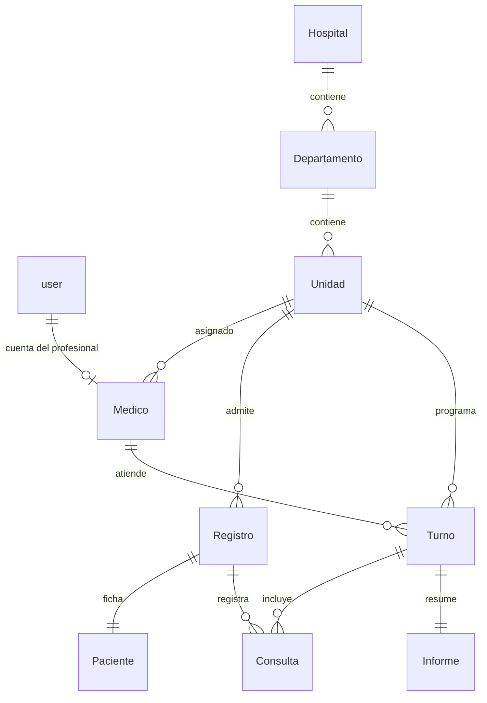

# Base de datos · Proyecto-DW

Rediseño del esquema relacional del Sistema de Gestión Hospitalaria para
PostgreSQL 17. Integra el ERD entregado, la tabla de usuarios (`user`) y la
relación entre **médico** y **usuario**. Los datos del perfil viven en
`"Medico"`, así que no se duplican en una tabla aparte.

## Archivos

| Archivo | Para qué sirve |
| --- | --- |
| `01_schema.sql` | Esquema completo. **Recrea** las tablas del esquema `public`. |
| `02_migracion_medico_usuario.sql` | Migración (paso 1): agrega la relación médico–usuario y `dirMed` a una base existente. No elimina `data_user`. |
| `02b_eliminar_data_user.sql` | Migración (paso 2): copia la dirección, verifica que todas las cuentas tengan médico, elimina `data_user` y simplifica la PK de `"user"`. |
| `03_views.sql` | Vistas de apoyo: jerarquía, médico–usuario, paciente–unidad y ocupación de unidades. |
| `CRUD/` | Funciones PL/pgSQL de alta, modificación y baja. |
| `Reportes/` | Funciones de los nueve reportes. |
| `Trigger/` | Funciones y disparadores de informe automático y límite de médicos. |
| `Datos de Prueba/` | Datos de ejemplo. |

## Modelo



### Relación médico–usuario

La relación se resuelve con una clave foránea en `"Medico"`:

```text
"user".username  (UNIQUE)
        ▲
        │  FK: ON UPDATE CASCADE / ON DELETE SET NULL
        │
"Medico".username (UNIQUE, NULL permitido)
```

- Es **1:1 opcional**: un usuario puede no tener médico y un médico puede no
  tener cuenta.
- `UNIQUE("Medico".username)` impide que la misma cuenta quede vinculada a dos
  médicos.
- Si se elimina la cuenta, el registro profesional se conserva y queda sin
  usuario (`ON DELETE SET NULL`).
- El usuario vinculado debe tener rol `MEDICO`. La validación del rol queda en
  la aplicación para no bloquear promociones a `ADMIN`.
- **No hay `data_user`**: el perfil del usuario es la ficha del médico
  (`nomMed`, `espMed`, `telMed`, `dirMed`). El hospital también se deduce:
  `"Medico" → "Unidad" → "Departamento" → "Hospital"`, así que no se guarda
  en la cuenta.

Ejemplo:

```sql
INSERT INTO public."user" (username, email, password, role)
VALUES ('dr.juan', 'juan@hospital.test', '$2a$10$...', 'MEDICO');

UPDATE public."Medico"
SET username = 'dr.juan'
WHERE "codMed" = 'M001';
```

Consulta de la relación:

```sql
SELECT *
FROM public."vw_MedicoUsuario"
WHERE username IS NOT NULL;
```

## Tablas

### Usuarios

| Tabla | Propósito | Clave |
| --- | --- | --- |
| `"user"` | Credenciales y rol (`ADMIN` / `MEDICO`). | `username` + `UNIQUE(email)` |
| `"reset_tokens"` | Recuperación de contraseña. | `id`; `email` → `"user"(email)` |

El perfil del usuario (nombre, especialidad, dirección y teléfono) **no está
en `"user"`**: se lee de `"Medico"` mediante `"Medico".username`.

### Estructura hospitalaria

| Tabla | Propósito | Relaciones |
| --- | --- | --- |
| `"Hospital"` | Nodo superior. | — |
| `"Departamento"` | División del hospital. | `codHos` → `"Hospital"` |
| `"Unidad"` | Área operativa. | `codDep` → `"Departamento"` |

### Pacientes

| Tabla | Propósito | Relaciones |
| --- | --- | --- |
| `"Registro"` | Admisión vigente del paciente en una unidad. | `codUni` → `"Unidad"` |
| `"Paciente"` | Ficha demográfica. | `numHisCli` → `"Registro"` |

> `"Registro"` es la raíz de la admisión y `"Paciente"` su ficha 1:1. Esta
> dirección mantiene compatibles los scripts existentes: `insertarPaciente`
> inserta primero el registro y después el paciente, y `eliminarPaciente`
> elimina el registro esperando el borrado en cascada.

### Personal y operación

| Tabla | Propósito | Relaciones |
| --- | --- | --- |
| `"Medico"` | Profesional asignado a una unidad; también es el perfil del usuario. | `codUni` → `"Unidad"`; `username` → `"user"` |
| `"Turno"` | Turno de atención. | `codUni` → `"Unidad"`; `codMed` → `"Medico"` |
| `"Consulta"` | Atención de un paciente en un turno. | `numTur` → `"Turno"`; `numHisCli` → `"Registro"` |
| `"Informe"` | Resumen automático de un turno. | `codUni` → `"Unidad"`; `numTur` → `"Turno"` |

Claves primarias y reglas destacadas:

- `"Consulta"`: PK compuesta `(numTur, numHisCli)`. Evita duplicar el mismo
  paciente en el mismo turno.
- `"Informe"`: PK `numIn`, `UNIQUE(numTur)`. Un informe por turno.
- `"Paciente"`: `CHECK` de edad mínima de 16 años.
- `"Medico"`: `UNIQUE(numLic)`, `UNIQUE(username)` y `CHECK("exp" >= 0)`.
  `"dirMed"` es opcional y guarda la dirección de contacto del profesional.
- `"user"`: PK `username` y `UNIQUE(email)`; no contiene datos personales.
- Todas las claves foráneas usan `ON UPDATE CASCADE`; las jerarquías usan
  `ON DELETE CASCADE`.

## Correcciones al ERD adjunto

| Problema en el ERD entregado | Corrección aplicada |
| --- | --- |
| No existía la tabla `unidad`, pero todas las funciones y entidades la usan. | Se creó `"Unidad"` entre `"Departamento"` y las tablas operativas. |
| `medico.codUni`, `registro.codUni` e `informe.codUni` apuntaban a `departamento.codDep`. | Ahora apuntan a `"Unidad"."codUni"`, que es la jerarquía real usada por los reportes. |
| Las FK de `informe`, `medico` y `registro` declaraban la columna `codDep`, que no existe en esas tablas. | Se usan las columnas reales (`codUni`) y la tabla destino correcta (`"Unidad"`). |
| `paciente` no tenía clave primaria. | PK `numHisCli` + FK a `"Registro"`. |
| `consulta` no tenía clave primaria. | PK compuesta `(numTur, numHisCli)`. |
| `turno` no declaraba FK para `codUni`. | FK `codUni` → `"Unidad"`. |
| `informe` no impedía más de un informe por turno. | `UNIQUE(numTur)`. |
| `nomPac` era `varchar(10)` y no admite los nombres de los datos reales. | `varchar(100)`; también se ampliaron `dirPac`, `telMed` y `numLic`. |
| No existía relación entre médico y usuario. | `"Medico".username` → `"user".username`, 1:1 con `UNIQUE`. |
| El ERD no incluía las tablas de usuarios ni recuperación de contraseña. | Se incorporaron `"user"` y `"reset_tokens"`; el perfil se resolvió con `"Medico"` para no duplicar datos. |
| El ERD no tenía dónde guardar la dirección del usuario. | Se agregó `"Medico"."dirMed"`. |

## Compatibilidad con los scripts existentes

El esquema conserva **los nombres exactos** de tablas y columnas que ya usan
las funciones:

- `public."Hospital"("codHos","nomHos")`
- `public."Departamento"("codDep","nomDep","codHos")`
- `public."Unidad"("codUni","nomUni","ubiUni","codDep")`
- `public."Medico"("codMed","nomMed","espMed","numLic","telMed","codUni","exp","datCon","dirMed")`
- `public."Paciente"("numHisCli","nomPac","dirPac","fechaN")`
- `public."Registro"("estPac","codUni","numHisCli","fecha_admision")`
- `public."Turno"("numTur","cantAtenTur","estTur","codUni","codMed")`
- `public."Consulta"("numTur","numHisCli","atendido","causa")`
- `public."Informe"("hora","fecha","numIn","pacAten","pacAlt","cantAdm","total","codUni","numTur")`

`"Medico".username` y `"dirMed"` son las únicas columnas nuevas y son
opcionales, por lo que las funciones actuales que insertan médicos sin usuario
siguen funcionando.

## Registro de usuarios

El registro sigue este flujo:

1. Si la tabla `"user"` está vacía, la primera cuenta se crea como `ADMIN`
   y no se vincula a ningún médico.
2. A partir de la segunda cuenta, el formulario pide **Hospital → Unidad →
   Médico**.
3. El desplegable de médicos solo muestra profesionales con `username IS NULL`,
   es decir, que todavía no tienen cuenta.
4. El paso final pide **username, email y contraseña**. No se piden nombre,
   especialidad, teléfono ni dirección: esos datos salen de `"Medico"`.

El backend valida en una sola transacción que el médico exista, que no tenga
cuenta y que la cuenta nueva quede vinculada. Si dos personas intentan
registrar al mismo médico a la vez, la segunda recibe un error.

> Este registro crea cuentas para médicos existentes. Si el sistema va a estar
> expuesto en una red, conviene que esa pantalla quede detrás de una sesión
> `ADMIN`, porque hoy es pública.

## Cómo ejecutar

### Base nueva

```bash
psql -U postgres -d sistema -v ON_ERROR_STOP=1 -f database/01_schema.sql

# Funciones CRUD
for f in database/CRUD/Insertar/*.sql \
         database/CRUD/Modificar/*.sql \
         database/CRUD/Eliminar/*.sql; do
    psql -U postgres -d sistema -v ON_ERROR_STOP=1 -f "$f"
done

# Datos de prueba (ver nota más abajo)
psql -U postgres -d sistema -v ON_ERROR_STOP=1 \
  -f "database/Datos de Prueba/deepseek_sql_20260622_f6000b.sql"
psql -U postgres -d sistema -v ON_ERROR_STOP=1 \
  -f "database/Datos de Prueba/deepseek_sql_20260622_66b3c9.sql"

# Disparadores (después de los datos de prueba)
psql -U postgres -d sistema -v ON_ERROR_STOP=1 \
  -f "database/Trigger/Function-(actualizar_informe).sql"
psql -U postgres -d sistema -v ON_ERROR_STOP=1 \
  -f "database/Trigger/Function-(limite de medicos).sql"
psql -U postgres -d sistema -v ON_ERROR_STOP=1 \
  -f "database/Trigger/trigger-actualizar_informe.sql"
psql -U postgres -d sistema -v ON_ERROR_STOP=1 \
  -f "database/Trigger/trigger-limite de medicos.sql"

# Reportes y vistas
for f in database/Reportes/*.sql; do
    psql -U postgres -d sistema -v ON_ERROR_STOP=1 -f "$f"
done
psql -U postgres -d sistema -v ON_ERROR_STOP=1 -f database/03_views.sql
```

### Base existente

La migración se hace en dos pasos para no perder la dirección de las cuentas
que todavía no tienen médico asignado:

```bash
# 1. Preparar el modelo: Medico.username, Medico."dirMed", UNIQUE y FK.
psql -U postgres -d sistema -v ON_ERROR_STOP=1 \
  -f database/02_migracion_medico_usuario.sql

# 2. Vincular cada cuenta existente con su ficha de médico.
#    data_user todavía existe, así que se puede revisar el perfil antes.
UPDATE public."Medico" m
SET username = u.username
FROM public."user" u
WHERE m.username IS NULL
  AND lower(btrim(m."nomMed")) = lower(btrim(u.username));

# Comprobar que ninguna cuenta quedó sin médico.
SELECT u.username
FROM public."user" u
LEFT JOIN public."Medico" m ON m.username = u.username
WHERE m."codMed" IS NULL;

# 3. Copiar la dirección, eliminar data_user y simplificar la PK.
psql -U postgres -d sistema -v ON_ERROR_STOP=1 \
  -f database/02b_eliminar_data_user.sql

# 4. Recrear las vistas (vw_MedicoUsuario ya no usa data_user).
psql -U postgres -d sistema -v ON_ERROR_STOP=1 \
  -f database/03_views.sql
```

`02b` se detiene sin borrar nada si todavía hay cuentas con `data_user` que no
están vinculadas a un médico. En ese caso muestra los usernames pendientes;
vincúlelos y vuelva a ejecutar el archivo. Ambos scripts son idempotentes.

No se borran pacientes, médicos, turnos, consultas ni informes. Los datos de
`data_user` que ya existen en `"Medico"` (`nombre`, `especialidad`, `telefono`)
se descartan porque son redundantes; la dirección se conserva en `"dirMed"`.

## Notas importantes

### 1. Los archivos de datos de prueba no son acumulables

- `deepseek_sql_20260622_f6000b.sql` contiene el conjunto completo
  (hospitales `H001`–`H008`).
- `deepseek_sql_20260622_d6c621.sql` vuelve a insertar `H006`–`H008` con otros
  códigos de departamento (`D018`–`D023`), por lo que **no debe ejecutarse
  junto con `f6000b`**.
- `deepseek_sql_20260622_66b3c9.sql` agrega pacientes al hospital `H002` y
  depende de las unidades creadas por `f6000b`.

Orden recomendado: `f6000b` → `66b3c9`.

### 2. Crear los disparadores después de los datos de prueba

Si el disparador `trg_actualizar_informe` está activo mientras se cargan los
datos, cada `INSERT` en `"Consulta"` crea o actualiza un informe. Después, el
`INSERT` explícito de `"Informe"` que trae el archivo de datos choca con
`UNIQUE("numTur")`. Dos alternativas:

1. Cargar los datos antes de crear los disparadores (orden recomendado arriba).
2. Desactivar el disparador durante la carga:

```sql
ALTER TABLE public."Consulta" DISABLE TRIGGER trg_actualizar_informe;
-- cargar los datos
ALTER TABLE public."Consulta" ENABLE TRIGGER trg_actualizar_informe;
```

### 3. Formato de `"Informe"."numIn"`

Los datos de prueba usan valores como `I001`, `I002`. El disparador actual
genera valores numéricos (`1`, `2`, …) con la secuencia
`public.seq_num_informe`. Ambos formatos caben en `varchar(10)`, pero conviene
unificarlos si se quiere un identificador homogéneo.

### 4. Cambio del número de historia clínica

`modificarPaciente` actualiza primero `"Registro"` y después `"Paciente"`. Como
la FK de `"Paciente"` tiene `ON UPDATE CASCADE`, el cambio de clave se propaga
antes del segundo `UPDATE`. El script de la carpeta `CRUD/Modificar` ya está
ajustado para usar el número nuevo en ese segundo `UPDATE`; si se reemplaza
por una versión anterior, hay que conservar ese ajuste o el nombre, la
dirección y la fecha de nacimiento no se actualizarán al cambiar el número de
historia.

### 5. Una sola fuente de verdad para el perfil

`"Medico"` es la única fuente de verdad de los datos personales y
profesionales:

| Dato | Columna |
| --- | --- |
| Nombre | `"nomMed"` |
| Especialidad | `"espMed"` |
| Teléfono | `"telMed"` |
| Dirección | `"dirMed"` |

`"user"` solo guarda credenciales (`username`, `email`, `password`, `role`).
La pantalla de perfil de la aplicación edita la ficha de `"Medico"` cuando el
usuario tiene una vinculada. Un `ADMIN` sin médico no tiene campos
profesionales que editar.

La migración `02b_eliminar_data_user.sql` copia `data_user.direccion` a
`"Medico"."dirMed"` antes de eliminar `data_user`. Los demás datos de
`data_user` se descartan porque ya existen en `"Medico"`. Si una cuenta no
está vinculada a un médico, el script se detiene para no perder esa dirección.

### 6. Hibernate

El esquema coincide con la entidad JPA `User` (PK `username`). Para producción
se recomienda cambiar

```properties
spring.jpa.hibernate.ddl-auto=update
```

por `validate`, y administrar los cambios con los scripts de esta carpeta.

## Verificación realizada

El esquema fue probado en PostgreSQL 17 con:

- `01_schema.sql` en una base vacía: 8 hospitales, 20 unidades, 16 médicos,
  600 pacientes y sin `data_user`.
- Todas las funciones de `CRUD/`, `Trigger/` y `Reportes/`.
- Los datos de prueba `f6000b` + `66b3c9`.
- Las vistas de `03_views.sql`.
- La migración dividida `02` + `02b` sobre una base con `data_user`:
  - `02` deja `data_user` intacta y la PK compuesta sin cambios.
  - `02b` aborta sin borrar nada cuando hay cuentas sin médico.
  - después de vincular, copia `direccion` a `"dirMed"`, elimina `data_user`
    y deja `"user"` con PK `username`.
  - ambos scripts se pueden ejecutar dos veces sin errores.
  - `ON DELETE SET NULL` conserva la ficha del médico al eliminar la cuenta.
- El flujo de registro en la aplicación:
  - primer usuario → `ADMIN` sin médico;
  - siguientes → `MEDICO` vinculado a un médico sin cuenta;
  - registro duplicado del mismo médico rechazado;
  - perfil leído y actualizado sobre `"Medico"`.

Resultado: las funciones compilan, los datos cargan, los reportes devuelven
resultados y la migración no pierde información cuando las cuentas están
vinculadas.
